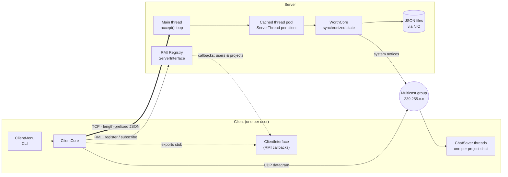
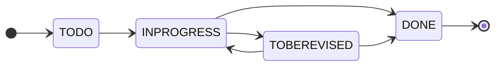

**Author:** Giuseppe Muschetta  
**University:** University of Pisa  
**Degree:** B.Sc. in Computer Science  
**Course:** Network Programming (Laboratorio di Reti)

---

<div align="center">

# WORTH — WORkTogetHer

### A Distributed, Kanban-Inspired Collaboration Platform in Pure Java


**3,600+ lines of Java · 19 classes · 4 communication mechanisms · zero frameworks**

[Read the technical report](REPORT.pdf) · [Italian version](RELAZIONE.pdf) · [Architecture](#architecture) · [Get it running](#getting-started)

</div>

---

How do you let a team of people, each on their own machine, create projects, move tasks across a Kanban board, see who is online and chat in real time — **without a single framework**, using only sockets, threads and the Java standard library?

WORTH answers that question. It is a complete **client-server system** in which every networking primitive is chosen for the job it does best:

- **TCP** carries every request and response, with a custom length-prefixed JSON protocol.
- **Java RMI** handles user registration and pushes **server-to-client callbacks** whenever the shared state changes.
- **UDP multicast** gives every project its own group chat, with addresses allocated from a managed pool.
- **NIO channels** persist the whole system state to disk, so nothing is lost when the server restarts.

All of it runs on a **multithreaded server** that serves any number of clients concurrently while keeping shared data consistent.

## Highlights

| Area | What WORTH does |
|:---|:---|
| **Concurrency** | A cached thread pool assigns a worker to each connected client; shared users and projects are guarded by `synchronized` blocks for atomic, consistent updates. |
| **Custom wire protocol** | Every message is a JSON-serialized `Message` object, preceded by a 4-byte length header, so the receiver allocates exactly the bytes it needs, over buffered data streams. |
| **Push notifications** | Clients export an RMI stub at login; the server calls back every connected client when users register, log in or out, or when projects are created or deleted. |
| **Per-project chat** | Each project gets its own multicast address from `239.255.224.0` to `239.255.255.255`, a pool of **8,192 chats**, allocated smallest-first from a sorted `TreeSet` and returned when a project is deleted. |
| **Secure credentials** | Passwords are never stored in clear text. They are hashed with **PBKDF2-HMAC-SHA1**, a **32-byte random salt** and **20,000 iterations**. |
| **Persistence** | Users, projects, members and cards are saved as JSON files through NIO `FileChannel`s after every state-changing operation, and restored on startup. |
| **Fault tolerance** | Abrupt client disconnections are detected (`EOFException`), the user is logged out, the socket is closed and stale callback stubs are pruned automatically. |
| **Workflow rules** | Cards follow a Kanban life cycle with enforced transitions, a full movement history, and projects can only be deleted once every card is done. |

## Architecture



### Communication at a glance

| Mechanism | Used for | Port |
|:---|:---|:---|
| TCP | Login, logout and every project and card operation | `45678` |
| Java RMI | User registration, callback subscription, state push to clients | `56789` (registry) |
| UDP multicast | Project chats and automatic notifications such as "card X moved to DONE" | `13731` |
| NIO file channels | Persisting users, projects, members and cards as JSON | — |

### Threads

| Side | Thread | Role |
|:---|:---|:---|
| Server | Main thread | Restores state, starts the RMI registry, blocks on `accept()` and hands each connection to the pool. |
| Server | Pool workers | Read requests, run them against `WorthCore`, persist changes and send responses; handle sudden disconnects. |
| Server | RMI thread | Serves remote calls on `ServerInterface`. |
| Client | Main thread | Runs the CLI and all TCP communication. |
| Client | `ChatSaver` threads | One per project chat; block on the multicast socket and store incoming messages until the user reads them. |
| Client | RMI thread | Receives callbacks with up-to-date user and project lists. |

## The Kanban workflow

Every card starts in **TODO** and moves through the board according to these rules. Any other move is rejected by the server with `MOVE_CARD_FORBIDDEN`, and every valid move is recorded in the card's history and announced in the project chat.



A project can be cancelled only when **all of its cards are in DONE**. Its chat address is then released back to the pool.

## Commands

The client is an interactive command-line interface. `help` only shows the commands that are available at that moment: before login, you can only register, log in or exit.

| Command | Description |
|:---|:---|
| `register <nickname> <password>` | Create a new account (via RMI) |
| `login <nickname> <password>` | Log in and subscribe to callbacks |
| `logout <nickname>` | Log out |
| `list_users` | All registered users and their status |
| `list_online_users` | Users currently online |
| `list_projects` | Projects you are a member of |
| `create_project <project>` | Create a project and its chat |
| `add_member <project> <nickname>` | Add a user to a project |
| `show_members <project>` | List project members |
| `show_cards <project>` | List all cards of a project |
| `show_card <project> <card>` | Show a card's description and current list |
| `add_card <project> <card> <description>` | Add a card to TODO |
| `move_card <project> <card> <source> <dest>` | Move a card between lists |
| `get_card_history <project> <card>` | Show every list a card has been through |
| `send <project> <message>` | Send a message to the project chat |
| `receive <project>` | Read the chat messages received so far |
| `cancel_project <project>` | Delete a project once all its cards are done |
| `help` / `exit` | Show commands / quit |

> **Note:** the interface messages are in Italian, as the project was developed for an Italian university course.

## Getting started

**Requirements:** a JDK, version 8 or later. The project was developed and tested on Java 8 and 15, on both UNIX and Windows. The Jackson libraries are already included in `lib/`.

Start the **server first**, then as many **clients** as you like, each in its own terminal. A client started without a running server exits straight away and says that the service is unavailable.

### macOS / Linux

```bash
CP="lib/jackson-annotations-2.9.7.jar:lib/jackson-databind-2.9.7.jar:lib/jackson-core-2.9.7.jar"

# compile
javac -d out -cp "$CP" src/*.java

# run the server
java -cp "out:$CP" ServerMain

# run a client (in another terminal)
java -cp "out:$CP" ClientMain
```

### Windows

```bat
set CP=lib\jackson-annotations-2.9.7.jar;lib\jackson-databind-2.9.7.jar;lib\jackson-core-2.9.7.jar

javac -d out -cp %CP% src\*.java
java -cp out;%CP% ServerMain
java -cp out;%CP% ClientMain
```

### A quick tour

```text
register alice secret
login alice secret
create_project website
add_card website homepage Build the landing page
move_card website homepage todo inprogress
move_card website homepage inprogress done
get_card_history website homepage
send website The homepage is live!
receive website
cancel_project website
```

Open a second client, register `bob`, add him with `add_member website bob`, and watch both users receive chat messages and live updates.

The server keeps its state in a `res/` folder in the project root. Delete it to start from a clean system.

## Project structure

```text
WORTH-Real-Time-Kanban-in-Java/
├── RELAZIONE.pdf            # 12-page technical report (Italian)
├── REPORT.pdf              # 12-page technical report (English)
├── lib/                     # Jackson 2.9.7 (core, databind, annotations)
└── src/
    ├── ServerMain.java      # Server entry point (TCP 45678, RMI 56789)
    ├── ServerCore.java      # Accept loop, thread pool, RMI callbacks, NIO persistence
    ├── ServerThread.java    # Per-client worker: read request → process → respond
    ├── ServerInterface.java # Remote interface: registration and callback subscription
    ├── WorthInterface.java  # Contract of the WORTH service
    ├── WorthCore.java       # Synchronized state, Kanban rules, multicast address pool
    ├── ClientMain.java      # Client entry point
    ├── ClientMenu.java      # Command-line interface and input validation
    ├── ClientCore.java      # TCP requests, RMI stub, chat thread management
    ├── ClientInterface.java # Remote interface for server-to-client callbacks
    ├── ChatSaver.java       # Multicast listener, one thread per chat
    ├── Message.java         # JSON-serialized protocol envelope
    ├── Request.java         # Request types
    ├── Response.java        # Response and error codes
    ├── User.java  Project.java  Card.java  Chat.java
    └── HashPassword.java    # PBKDF2 salted password hashing
```

## What this project demonstrates

- Designing a **multi-protocol distributed system** and choosing TCP, RMI or UDP multicast for each kind of interaction.
- **Concurrent server programming** with thread pools and synchronized access to shared state.
- Designing a **binary-safe application protocol** with explicit message framing.
- The **observer pattern across the network**, through RMI callbacks.
- **Resource management**, with a bounded pool of multicast addresses that are allocated and reclaimed.
- **Durable state** with JSON serialization and NIO file channels.
- **Security basics** done right: salted, iterated password hashing.

## Technical report

[`REPORT.pdf`](REPORT.pdf) is the full 12-page technical report, in English. It describes the architecture, the TCP protocol, the RMI callbacks, the multicast chats, the server and the client, the Kanban rules and the password hashing, and closes with a scripted session that exercises every request, the callbacks, the chat, persistence across a restart and an abrupt disconnection.

[`RELAZIONE.pdf`](RELAZIONE.pdf) is the original 12-page report written for the exam, in Italian.

---

<div align="center">

Made by **Giuseppe Muschetta** · [GitHub](https://github.com/giuseppemuschetta) · [LinkedIn](https://www.linkedin.com/in/giuseppemuschetta/)

</div>
